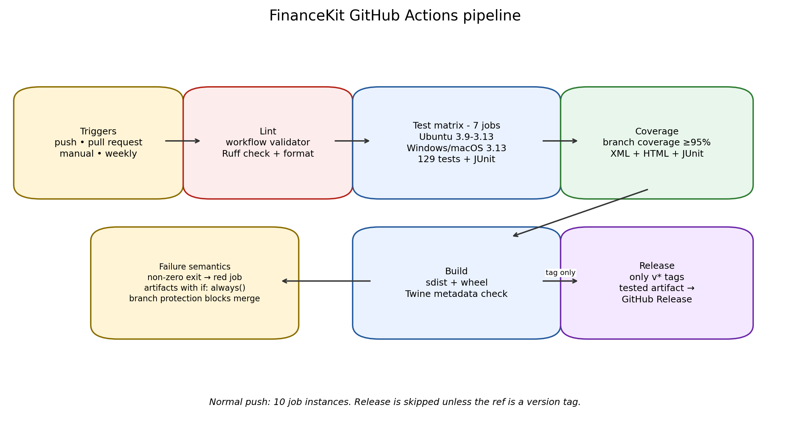

# Week 6 — Continuous Integration for FinanceKit


This project takes the tested **FinanceKit** personal-finance library from
Week 3 and puts it behind a production-style **GitHub Actions** continuous
integration pipeline. Every push and pull request automatically checks code
style, runs the test suite across operating systems and Python versions,
enforces a coverage floor, generates reports, and builds validated Python
distributions.

The aim is not merely to add a YAML file. The pipeline is accompanied by:

- a local runner that executes the same gates before pushing;
- a semantic workflow validator;
- generated JUnit and coverage artifacts;
- a deliberate-failure experiment proving that a broken test turns the gate red;
- local Git trigger simulation and exact hosted-verification instructions;
- measured timings and troubleshooting notes for the problems encountered.

## Headline results

| Measure | Verified result |
|---|---:|
| Existing test suite reused | 129 automated tests |
| Branch coverage | **98.44%** |
| Coverage gate | **95% minimum** |
| Workflow job definitions | 5 |
| Job instances on a normal push | 10 (1 lint + 7 tests + 1 coverage + 1 build) |
| Test 3 |
| Operating systems in matrix | Ubuntu, Windows, macOS |
| Ruff lint findings after cleanup | 0 |
| Ruff format check | Pass |
| Distribution build | sdist + wheel, validated with Twine |
| Deliberate broken test | Local CI exits non-zero and stops at the test gate |
| Runtime dependencies of FinanceKit | None (Python standard library only) |



## What FinanceKit does

FinanceKit is a dependency-free Python library for personal-finance
calculations:

- simple and compound interest, present/future value and effective rates;
- NPV, IRR, CAGR, SIP future value and required monthly saving;
- loan payments, amortization schedules and summaries;
- mean/variance/standard deviation, Sharpe ratio, drawdown and correlation;
- CSV cashflow loading and combined investment/loan reports.

The Week 6 maintenance release is **FinanceKit 1.1.0**. Its public
mathematical behaviour is unchanged from Week 3; the changes are CI,
packaging metadata, lint/format compliance and developer-workflow tooling.

## Quick start

All commands assume you are in the repository root—the directory containing
this `README.md`, `pyproject.toml` and `.github/`.

### Use the library

```bash
python -m venv .venv
source .venv/bin/activate          # Windows: .venv\Scripts\Activate.ps1
python -m pip install --editable .
python examples/demo.py
```

```python
import financekit as fk

print(fk.compound_amount(10_000, 12, 1, 12))
print(fk.monthly_payment(100_000, 12, 12))
print(fk.npv(0.10, [-1_000, 400, 400, 400]))
```

### Install development tools

```bash
python -m pip install -r requirements-dev.txt
python -m pip install --editable .
```

### Run the same gates locally

Recommended one-command local CI:

```bash
python scripts/run_ci_locally.py
```

Useful variants:

```bash
python scripts/run_ci_locally.py --install
python scripts/run_ci_locally.py --skip-build
python scripts/run_ci_locally.py --keep-going
./scripts/run_ci_locally.sh
```

Windows PowerShell:

```powershell
./scripts/run_ci_locally.ps1
```

Individual gates:

```bash
python scripts/validate_workflow.py
python -m ruff check .
python -m ruff format --check .
python -m pytest -vv
python -m pytest --cov=financekit --cov-branch --cov-fail-under=95 --cov-report=term-missing
python -m build
python -m twine check dist/*
```

If GNU Make is available, `make ci`, `make lint`, `make test`, `make coverage`
and `make build` wrap the same commands.

## GitHub Actions pipeline

The workflow is [`.github/workflows/ci.yml`](.github/workflows/ci.yml).

### Triggers

| Event | Behaviour |
|---|---|
| `push` | Runs for every pushed commit/branch and version tag |
| `pull_request` | Runs before merge so reviewers see the same gates |
| `workflow_dispatch` | Allows a manual run from GitHub's Actions tab |
| `schedule` | Weekly Monday 03:17 UTC regression run; distribution build is skipped |
| Tag `v*` | Also publishes a GitHub Release after all quality gates and the build pass |

There are deliberately **no path filters**: a documentation-only change still
exercises the workflow, satisfying the “every commit” requirement and avoiding
surprises where a supposedly harmless edit bypasses validation.

### Jobs and quality gates

| Job | Gate | Failure behaviour |
|---|---|---|
| `lint` | Semantic workflow validation; `ruff check`; `ruff format --check` | Any finding or formatting drift fails the job |
| `test` | Byte-compilation plus 129 pytest tests on 7 OS/Python combinations; JUnit XML per combination | Any failed test fails that matrix job; `fail-fast: false` still reports the other combinations |
| `coverage` | Branch coverage with terminal/XML/HTML reports | Fails below 95%; current result 98.44% |
| `build` | Build sdist and wheel; `Twine check` | Runs only after lint, tests and coverage pass |
| `release` | Download distributions and create a GitHub Release | Only for tags such as `v1.1.0`; this is the only job with write permission |

The default GitHub token permission is `contents: read`. Write permission is
scoped only to the tag-only release job.

### Reports and artifacts

| Artifact | Contents | Retention |
|---|---|---:|
| `test-results-<os>-py<version>` | JUnit XML for that matrix combination | 14 days |
| `coverage-report` | `coverage.xml`, HTML coverage site and coverage JUnit XML | 14 days |
| `python-distributions` | Source distribution and wheel | 30 days |

Test and coverage artifacts use `if: always()`, so they are uploaded even when
a test fails. That makes a red build diagnosable instead of merely red.

## Reproduce the hosted run

1. Create an empty GitHub repository named `week6_continuous_integration`.
2. Upload the **contents** of this project at the repository root; do not nest
   another `week6_continuous_integration/` folder inside it.
3. Push using the staged commits in
   [`docs/GITHUB_UPLOAD_GUIDE.md`](docs/GITHUB_UPLOAD_GUIDE.md).
4. Open **Actions → CI**. The push should start the workflow automatically.
5. Confirm the lint job, seven test combinations, coverage job and build job.
6. Download the JUnit, coverage and distribution artifacts from the run page.
7. Make a small documentation commit and push again; a second run should
   appear for the new commit SHA.
8. Optionally repeat the deliberate-failure experiment on a throwaway branch
   as described in [`docs/CI_PIPELINE.md`](docs/CI_PIPELINE.md), then delete
   that branch.

> The submission package contains complete local evidence generated with the
> same commands. A hosted run can only appear after the repository is pushed
> to the intern's GitHub account; the guide gives the exact verification
> checklist and log locations rather than fabricating a hosted screenshot.

## Branch protection recommendation

After the first successful hosted run, protect `main` with:

- require a pull request before merging;
- require status checks to pass before merging;
- select **Lint and format (Ruff)**, all seven **Test (...)** checks,
  **Coverage quality gate**, and **Build distributions**;
- require branches to be up to date before merging;
- block force pushes.

This turns CI from an informational dashboard into an actual merge gate.

## Release process

For a tested release:

```bash
git tag -a v1.1.0 -m "FinanceKit 1.1.0"
git push origin v1.1.0
```

The tag push runs the normal pipeline. If the build succeeds, the `release`
job downloads the distribution artifact and creates a GitHub Release with
generated notes. It does not publish to PyPI; that would require a separate
trusted-publishing decision and credentials.

## Project structure

```text
.
├── .github/
│   ├── dependabot.yml
│   └── workflows/ci.yml
├── README.md
├── SUBMISSION_DESCRIPTION.md
├── pyproject.toml
├── requirements*.txt
├── Makefile
├── financekit/                 # dependency-free library
├── tests/                      # 129 pytest tests
├── examples/demo.py
├── data/sample_cashflows.csv
├── scripts/
│   ├── run_ci_locally.py       # cross-platform local CI
│   ├── run_ci_locally.sh
│   ├── run_ci_locally.ps1
│   └── validate_workflow.py
├── tools/generate_evidence.py
├── docs/
│   ├── CI_PIPELINE.md
│   ├── TESTING.md
│   ├── EVIDENCE_INDEX.md
│   ├── WORK_LOG.md
│   ├── GITHUB_UPLOAD_GUIDE.md
│   └── evidence/figures/
└── results/ci_summary.json
```

## Documentation map

- [`docs/CI_PIPELINE.md`](docs/CI_PIPELINE.md) — architecture, job-by-job
  setup, failure semantics, local/hosted triggers, artifacts, release and
  troubleshooting.
- [`docs/TESTING.md`](docs/TESTING.md) — inherited test-suite design, markers,
  coverage and deliberate-failure case.
- [`docs/EVIDENCE_INDEX.md`](docs/EVIDENCE_INDEX.md) — every log, report and
  Figure with reproduction commands.
- [`docs/WORK_LOG.md`](docs/WORK_LOG.md) — process, errors encountered and
  design decisions.
- [`docs/GITHUB_UPLOAD_GUIDE.md`](docs/GITHUB_UPLOAD_GUIDE.md) — root-level
  upload, staged commits, hosted verification and branch protection.

## Known limitations

- Local execution proves the commands and gates on this machine; only a push
  to GitHub can prove GitHub's hosted runners and permissions.
- The matrix covers Python 3.9–3.13 on Ubuntu and 3.13 on Windows/macOS, not
  every OS/Python cross-product.
- Coverage measures executed lines/branches, not assertion quality. The
  inherited suite's known-value, boundary and integration assertions remain
  important.
- The tag release creates a GitHub Release, not a PyPI deployment.
- Action/tool versions require maintenance; Dependabot is configured to
  propose weekly GitHub Actions and pip updates.
